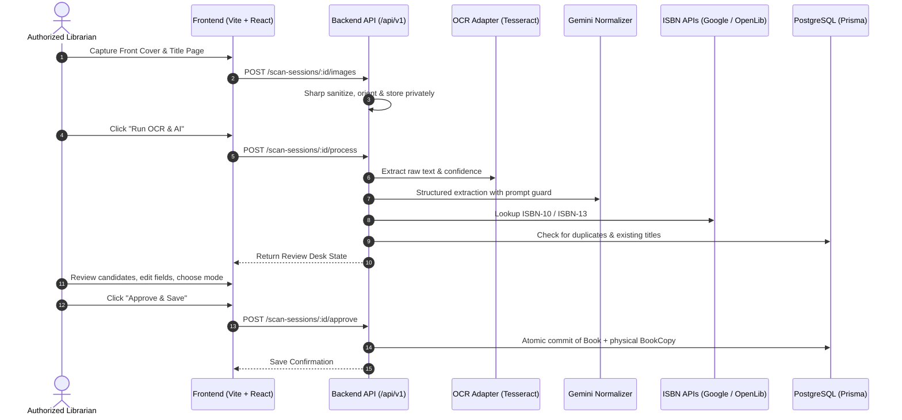

# University Library Management System (ULMS)
## Digital University of Cambodia (សាកលវិទ្យាល័យឌីជីថលកម្ពុជា)

> **Production-Oriented Web Application with AI Book Scanner & Auto Cataloging**

---

## 1. Overview & Architecture

The University Library Management System (ULMS) is a modern, full-stack, secure library automation platform developed for **Digital University of Cambodia (DUC)**. It supports Khmer as the default language with full English switchability, physical book-copy inventory management, transaction-safe borrowing and returns, and an AI Book Scanner that automates cataloging from mobile camera images.

### Key Highlights
- **Dual-Language UX**: Complete Khmer (ភាសាខ្មែរ) default interface with English option.
- **Normalized Bibliographic & Physical Model**: Bibliographic titles (`Book`) are strictly separated from physical inventory (`BookCopy`), each with unique accession identifiers.
- **Dynamic Availability Derivation**: Availability counts are never maintained via desynced static counters; they are dynamically queried from physical copy and loan states.
- **AI Book Scanner & Auto Cataloging**:
  - Dual-image mobile camera capture (Front Cover + Title/Copyright Page).
  - Pluggable OCR adapter (Tesseract.js with `khm` + `eng` support / Google Cloud Vision API).
  - Prompt-injection hardened AI normalizer (Google Gemini) with automatic regex fallback if no API key is provided.
  - External metadata verification via Google Books API and Open Library API with checksum validation.
  - Duplicate detection preventing title duplication while facilitating accessioned physical copy additions.
- **Transaction-Safe Circulation**: Atomic checkout/checkin preventing concurrent duplicate borrowing.
- **Enterprise Security**: Server-managed session authentication (`express-session` with HTTP-only cookies), role-based access control (Admin, Librarian, Student), rate limiting, and spreadsheet formula-injection protection on CSV exports.

---

## 2. Technology Stack

- **Frontend**: React 18, Vite, TypeScript, Tailwind CSS, Lucide Icons.
- **Backend**: Node.js, Express, TypeScript.
- **Database**: PostgreSQL 16 with Prisma ORM and Prisma Migrate.
- **Validation**: Zod schema validation across all API endpoints.
- **Image Pipeline**: Sharp (EXIF auto-orientation, safe format validation, private disk storage).
- **OCR Engine**: Tesseract.js (supports Khmer `khm` and English `eng`).
- **AI Engine**: Google Gemini API (`gemini-2.5-flash`) with structured JSON schema output and intelligent heuristic fallback.
- **External ISBN Services**: Google Books API & Open Library API.
- **Testing**: Vitest, Supertest.

---

## 3. Quick Start & Local Setup

### Prerequisites
- Node.js >= 20.x
- Docker & Docker Compose (or local PostgreSQL)

### Step 1: Clone and Configure Environment
Copy `.env.example` to `server/.env`:
```bash
cp .env.example server/.env
```

### Step 2: Start PostgreSQL Database
Using Docker Compose:
```bash
docker compose up -d
```
*(If you are using Supabase or Neon cloud PostgreSQL, update `DATABASE_URL` in `server/.env` accordingly).*

### Step 3: Install Dependencies
```bash
# Install backend dependencies
cd server
npm install

# Install frontend dependencies
cd ../client
npm install
```

### Step 4: Run Prisma Database Migrations & Seed
In the `server/` directory:
```bash
# Push schema or run migration
npx prisma db push

# Populate default categories, staff accounts, members, and books
npm run prisma:seed
```

### Step 5: Start Development Servers
From the root directory:
```bash
# Start both server and client concurrently
npm run dev
```
Or start them individually:
- **Backend API**: `cd server && npm run dev` (Runs on `http://localhost:5000`)
- **Frontend Client**: `cd client && npm run dev` (Runs on `http://localhost:5173`)

---

## 4. Default Demo Accounts

The database seed provides standard university accounts:

| Role | Username | Password | Access Permissions |
| :--- | :--- | :--- | :--- |
| **Administrator** | `admin` | `admin123` | Full system access, categories, staff accounts, audit logs |
| **Librarian** | `librarian` | `librarian123` | AI Book Scanner, catalog CRUD, circulation, members, CSV import/export |
| **Student** | `student` | `student123` | Public catalog search, book availability check |

---

## 5. REST API Documentation (`/api/v1`)

All API routes are prefixed with `/api/v1`.

### Authentication
- `POST /api/v1/auth/login`: Authenticate with username and password, returns session cookie.
- `POST /api/v1/auth/logout`: Terminate session and clear cookie.
- `GET /api/v1/auth/me`: Current authenticated user profile.

### Books & Catalog
- `GET /api/v1/books`: Search catalog (`q`, `categoryId`, `language`, `page`, `limit`).
- `GET /api/v1/books/:id`: Bibliographic title details and real-time physical copy availability.
- `POST /api/v1/books`: Create book title (Librarian/Admin).
- `PUT /api/v1/books/:id`: Update book title (Librarian/Admin).
- `DELETE /api/v1/books/:id`: Archive/delete book (Librarian/Admin).

### Physical Copies
- `GET /api/v1/copies/book/:bookId`: List all physical copies for a title.
- `GET /api/v1/copies/lookup/:identifier`: Lookup copy by accession number or barcode.
- `POST /api/v1/copies`: Register physical copy with unique accession number (Librarian/Admin).
- `PUT /api/v1/copies/:copyId`: Update copy condition or shelf location.
- `DELETE /api/v1/copies/:copyId`: Delete physical copy.

### Circulation & Loans
- `POST /api/v1/loans/issue`: Issue book copy to member (atomic transaction).
- `POST /api/v1/loans/return`: Process book return and overdue calculation.
- `POST /api/v1/loans/renew`: Extend borrowing period (up to 2 times).
- `GET /api/v1/loans/active`: List current active loans.
- `GET /api/v1/loans/overdue`: List overdue loans.

### AI Book Scanner
- `POST /api/v1/scan-sessions`: Initialize draft scan session.
- `POST /api/v1/scan-sessions/:id/images`: Upload cover or title page.
- `POST /api/v1/scan-sessions/:id/images/:imageId/rotate`: Rotate image (90° increments).
- `GET /api/v1/scan-sessions/:id/images/:imageId`: Stream private image bytes (Librarian/Admin only).
- `POST /api/v1/scan-sessions/:id/process`: Trigger OCR and AI normalization.
- `GET /api/v1/scan-sessions/:id/review`: Fetch review desk state and duplicate check.
- `POST /api/v1/scan-sessions/:id/approve`: Approve and commit metadata into the official catalog.
- `POST /api/v1/scan-sessions/:id/cancel`: Cancel session and clean up temporary images.

### Reports & CSV
- `GET /api/v1/reports/inventory`: Real-time inventory counts and condition breakdown.
- `GET /api/v1/reports/circulation`: Circulation volume and overdue metrics.
- `GET /api/v1/csv/export/books`: Export catalog to CSV with formula-injection neutralization.
- `POST /api/v1/csv/import/preview`: Preview CSV import batch before commit.
- `POST /api/v1/csv/import/commit`: Commit imported rows in transaction.

### System & Health
- `GET /api/v1/health`: System health status and database connectivity check.
- `GET /api/v1/audit-logs`: Audit trail query (Admin only).

---

## 6. AI Book Scanner Workflow & Configuration



### Prompt-Injection Hardening
Scanned text is untrusted. The AI Normalizer wraps all raw book strings inside `<untrusted_scanned_book_text>` XML boundaries with strict system prompt guardrails forbidding code execution or instruction overrides.

---

## 7. Backup and Restore Procedures

### Automated Database Backup
Create a timestamped compressed backup using `pg_dump`:
```bash
# On Linux / macOS / Git Bash
pg_dump -U postgres -h localhost -p 5432 -F c -b -v -f "./backups/duc_ulms_backup_$(date +%Y%m%d_%H%M%S).dump" ulms_db

# On Windows PowerShell
$timestamp = Get-Date -Format "yyyyMMdd_HHmmss"
docker exec -t ulms_postgres pg_dump -U postgres -F c -b -v ulms_db > "./backups/duc_ulms_backup_$timestamp.dump"
```

### Database Restore
Restore an existing backup into a fresh database:
```bash
# 1. Terminate active connections and recreate the database
docker exec -i ulms_postgres psql -U postgres -c "DROP DATABASE IF EXISTS ulms_db;"
docker exec -i ulms_postgres psql -U postgres -c "CREATE DATABASE ulms_db;"

# 2. Restore from archive dump
docker exec -i ulms_postgres pg_restore -U postgres -d ulms_db -v < "./backups/duc_ulms_backup_YYYYMMDD_HHMMSS.dump"
```

---

## 8. Running Automated Test Suites

The test suite validates core business rules, ISBN checksums, AI normalizer resilience, and CSV security:
```bash
cd server
npm run test
```

Expected test results:
- `IsbnUtils`: Validates ISBN-10 (Mod 11) and ISBN-13 (Mod 10), extracts ISBNs from messy OCR blocks.
- `RegexFallbackNormalizer`: Confirms fallback extraction without external API keys and verifies Zod schema conformity.
- `CsvService`: Confirms neutralization of spreadsheet formula injection vectors (`=`, `+`, `-`, `@`, `\t`, `\r`).

---

## 9. Known Limitations & Roadmap

1. **Khmer OCR Fine-Tuning**: Tesseract OCR with `khm` traineddata provides basic Khmer character recognition. For production volume cataloging of vintage Khmer texts, connecting Google Cloud Vision API provides superior Khmer Unicode text segmentation.
2. **Barcode Scanner Hardware**: The system is fully compatible with standard USB/Bluetooth handheld barcode guns that type directly into active input fields.
3. **RFID Gate Integration**: Future releases will support SIP2 / NCIP protocols for automated library security gate integration.

